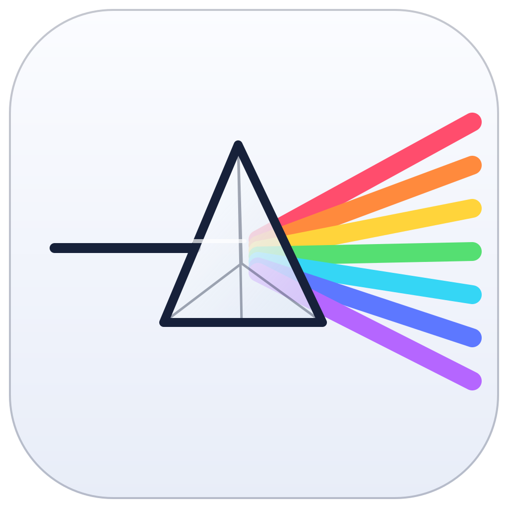

<p align="center">
  <picture>
    <source media="(prefers-color-scheme: dark)" srcset="./program_info/org.spectra.Spectra.logo-darkmode.svg">
    <source media="(prefers-color-scheme: light)" srcset="./program_info/org.spectra.Spectra.logo.svg">
    
  </picture>
</p>

<h1 align="center">光谱 0.0.1（Spectra 0.0.1）</h1>

<p align="center">
  面向 Minecraft 的可扩展、去中心化启动器<br>
  基于 Prism Launcher，采用 Qt 6 与标准 C++ 构建
</p>

<p align="center">
  <a href="https://github.com/yin-nicai/Spectra-Launcher/releases">
    
  </a>
  <a href="./LICENSE">
    
  </a>
  
</p>

> [!IMPORTANT]
> 本项目是 Prism Launcher 的非官方分支，与 Prism Launcher 项目、Mojang Studios、Microsoft 均无关联，也未获其认可或授权。本软件按“原样”提供，不附带任何明示或暗示的担保。使用本软件所产生的任何直接或间接后果，由使用者自行承担。

## 项目简介

光谱（Spectra）是一个独立维护的 Minecraft 启动器分支，目标是保留 Prism Launcher 成熟的实例管理能力，同时提供更清晰的现代化工作区、可插拔的元数据与下载源体系，以及更灵活的目录策略。

项目遵循以下原则：

- **面向接口编程**：资源发现、资源获取、目录解析和 UI 扩展通过 C++ 抽象接口与注册表接入。
- **去中心化配置**：元数据源和下载源可以独立启用、禁用、排序与回退。
- **用户数据优先**：目录策略切换不会静默移动或删除已有实例、日志、存档或资源缓存。
- **跨平台实现**：新增代码仅使用 Qt 与标准 C++，不依赖特定平台 API 或固定盘符。
- **合规下载**：Minecraft 本体、库和资源文件仅从 Mojang 官方域名或用户明确配置的镜像获取。

## 主要功能

### 实例与游戏管理

- 创建、导入、复制和整理多个互不影响的 Minecraft 实例。
- 管理原版游戏、模组加载器、模组、整合包、资源包、数据包、光影和世界。
- 支持 Microsoft 账户与离线账户。
- 未购买或未验证 Minecraft 所有权的账户可以使用完整离线模式进行本地游戏。
- 每次使用离线或未验证所有权账户启动时显示“支持正版 Minecraft”提示。

> 离线账户不能绕过正版验证服务器。加入 online-mode 服务器仍需要拥有 Minecraft 的有效账户。

### 现代化工作区

- 首页集中显示当前实例、启动状态、账户和常用操作。
- 一级导航提供首页、实例、下载、账户和设置入口。
- 常见操作包括启动游戏、选择实例、内存设置、打开游戏目录和下载源状态。
- 原生 System/Windows 11 主题保留系统控件绘制；深色与浅色自定义主题使用统一的工作区样式。
- 所有主题切换均沿用现有 Qt 调色板机制。

### 插件与源

- 元数据源接口：版本列表、依赖、文件哈希和下载描述。
- 下载源接口：候选 URL、优先级、镜像和失败回退。
- 目录策略接口：实例、游戏、资源、日志和崩溃报告根目录。
- UI 扩展接口：在现有 Qt Widgets 页面体系内追加可选功能。
- 资源配置页支持启用、禁用和调整元数据源、下载源、目录策略及资源平台顺序。

相关实现位于 [`launcher/plugin/`](./launcher/plugin/)。

### 下载与目录策略

- Minecraft 文件支持“官方 → 用户配置的国外镜像 → 用户配置的国内镜像”回退顺序。
- 下载前执行域名白名单检查；未配置的主机不会用于 Minecraft 文件下载。
- Modrinth、CurseForge 等模组与整合包下载保持原有提供方逻辑，不进入 Minecraft 本体镜像链。
- 修改资源或日志根路径时，已有实例和文件保持原位。
- 打开目录不会自动清空内容；危险清理操作需要用户确认。

### 启动器更新

本项目已移除启动器自身更新器和自动更新模块。当前版本不会在后台检查、下载或替换启动器文件。Minecraft 实例、模组和资源更新功能不受影响。

## 下载

请从 [GitHub Releases](https://github.com/yin-nicai/Spectra-Launcher/releases/latest) 获取正式构建。

当前 Windows 与 Linux 发布包包括：

| 平台 | 安装包 | 便携版 |
| --- | --- | --- |
| Windows x86_64 | `Spectra-0.0.1-Windows-x86_64-Setup.exe` | `Spectra-0.0.1-Windows-x86_64-Portable.zip` |
| Linux x86_64 | `Spectra-0.0.1-Linux-x86_64.deb` | `Spectra-0.0.1-Linux-x86_64.tar.gz` |

每个 Release 同时提供 `SHA256SUMS.txt`。下载后建议校验文件完整性：

```powershell
Get-FileHash .\Spectra-0.0.1-Windows-x86_64-Setup.exe -Algorithm SHA256
```

```bash
sha256sum -c SHA256SUMS.txt
```

> Windows 安装包当前未进行代码签名，首次运行时可能出现 SmartScreen 提示。

macOS 构建与安装包需要在 macOS、Xcode 和对应 Qt 环境中生成，尚未随当前 Release 提供。

## 快速开始

1. 下载并安装与你的系统对应的发布包，或解压便携版。
2. 首次启动时按照向导选择语言、Java 和主题。
3. 在“账户”页面添加 Microsoft 账户或创建离线账户。
4. 新建实例，选择 Minecraft 版本和需要的模组加载器。
5. 选择实例后点击“启动游戏”。

### 便携模式

Windows ZIP 和 Linux tar.gz 为便携构建。便携版会将用户数据保存在应用目录下，适合独立测试或放到可移动存储设备中使用。

### 数据兼容

光谱保留了一部分 Prism Launcher 配置、数据目录和协议兼容逻辑，便于从原启动器迁移。迁移前仍建议先备份整个实例与用户数据目录。

## 构建

### 依赖

- CMake 3.21 或更高版本
- Ninja
- Qt 6.4 或更高版本
- 支持 C++20 的编译器
- Java 运行时，用于启动 Minecraft
- `libraries/` 子模块及平台构建依赖

首次构建前确认子模块完整：

```bash
git submodule update --init --recursive
```

### Windows Release

在 MSYS2 CLANG64 环境中配置并构建：

```powershell
cmake -S . -B build -G Ninja -DCMAKE_BUILD_TYPE=Release
cmake --build build --config Release
```

生成的启动器位于 `build/Release/spectra.exe`。

### Linux Release

```bash
cmake -S . -B build-linux -G Ninja -DCMAKE_BUILD_TYPE=Release
cmake --build build-linux
```

### macOS Release

在安装 Xcode 和 macOS Qt 的主机上执行：

```bash
cmake -S . -B build-macos -G Ninja -DCMAKE_BUILD_TYPE=Release
cmake --build build-macos
```

## 项目结构

```text
launcher/
├── plugin/          # 元数据、下载、目录、资源平台及 UI 扩展接口
├── ui/              # Qt Widgets 界面、主题和页面
├── minecraft/       # 实例、启动、资源和账户逻辑
├── meta/            # 元数据读取与解析
├── net/             # 网络请求和下载任务
└── resources/       # 图标、主题资源和其他静态文件

program_info/        # 品牌资源、桌面集成和安装器配置
buildconfig/         # 构建信息生成
libraries/           # 上游子模块
```

## 开发约定

- 业务代码面向插件接口，不直接依赖固定的元数据服务器或下载实现。
- 新增路径处理使用 `QDir`、`QFileInfo` 和正斜杠，不硬编码盘符。
- UI 修改复用 Qt Widgets、`PageContainer` 和现有主题系统，不引入 QML。
- 不修改上游版权头、GPL-3.0 许可证原文或第三方归属信息。
- 不提交密钥、个人令牌、构建目录、安装包或锁文件。
- 提交前至少通过目标平台的 Release 构建。

## 问题反馈

请使用 [GitHub Issues](https://github.com/yin-nicai/Spectra-Launcher/issues) 报告可复现的问题。反馈时建议附上：

- 操作系统版本
- 光谱版本和 Git 提交
- 实例类型、Minecraft 版本和模组加载器
- 复现步骤
- 已脱敏的启动器日志

请勿在 Issue 中发布账户令牌、Microsoft 凭据、API Key 或其他敏感信息。

## 许可证与归属

本项目基于 [Prism Launcher](https://github.com/PrismLauncher/PrismLauncher)，源代码按 [GNU General Public License v3.0 only](./LICENSE) 发布。

本项目保留 Prism Launcher、MultiMC 及其贡献者的原版权与归属声明。项目名称、图标和其他品牌资源不改变上游代码的许可证义务。

本项目的名称、图标和发布包不得被用于暗示 Prism Launcher、Mojang Studios 或 Microsoft 对本分支提供认可、支持或授权。

## 免责声明

本项目是 Prism Launcher 的非官方分支，与 Prism Launcher 项目、Mojang Studios、Microsoft 均无关联，也未获其认可或授权。本软件按“原样”提供，不附带任何明示或暗示的担保。使用本软件所产生的任何直接或间接后果，由使用者自行承担。

请支持正版 Minecraft。在线游戏、正版验证服务器和相关服务仍受 Mojang Studios 与 Microsoft 的服务条款约束。
